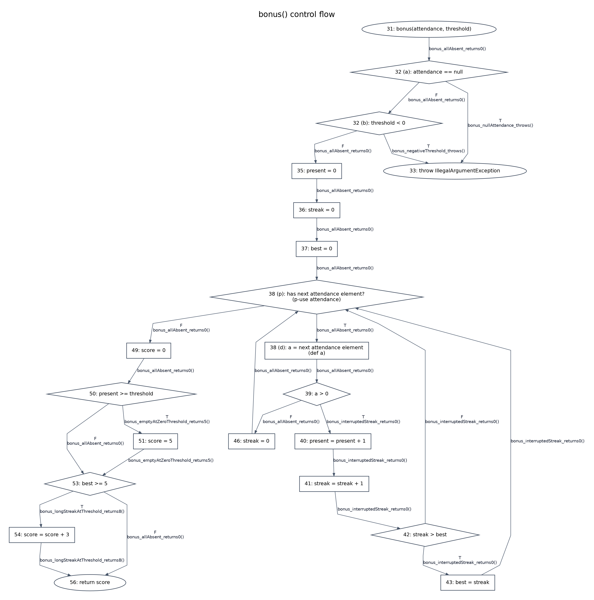

# Лаборатори 10 — Өгөгдлийн урсгалын тест

С. Энхбаяр / B232270153 / F.CSA313

## A. gcd-ийн DU хосууд

Мөрийн дугаар нь `DataFlowTargets.java` файлтай таарна. `13`-т `x`, `y` параметрүүд утгатай орж ирнэ. `14`-ийн `int tmp;` нь утга оноогоогүй зарлалт тул def гэж тооцоогүй.

`T`, `F` нь `15: y != 0` нөхцөлийн хоёр салаа. Хүснэгтэд 11 ялгаатай def–use хосыг p-use-ийн салаагаар нь салгаж, 13 мөрөөр харууллаа. Замын турш тухайн хувьсагчид дахин утга оноохгүй.

| Хувьсагч | Def мөр | Use мөр | Төрөл | Def-clear зам | Тестийн ID | Хамрагдсан |
|---|---:|---:|---|---|---|---|
| x | 13 | 16 | c-use | 13 → 15T → 16 | G02, G03 | Тийм |
| x | 13 | 20 | c-use | 13 → 15F → 20 | G01 | Тийм |
| x | 17 | 16 | c-use | 17 → 18 → 15T → 16 | G02 | Тийм |
| x | 17 | 20 | c-use | 17 → 18 → 15F → 20 | G02, G03 | Тийм |
| y | 13 | 15 (T) | p-use | 13 → 15T → 16 | G02, G03 | Тийм |
| y | 13 | 15 (F) | p-use | 13 → 15F → 20 | G01 | Тийм |
| y | 13 | 16 | c-use | 13 → 15T → 16 | G02, G03 | Тийм |
| y | 13 | 17 | c-use | 13 → 15T → 16 → 17 | G02, G03 | Тийм |
| y | 18 | 15 (T) | p-use | 18 → 15T → 16 | G02 | Тийм |
| y | 18 | 15 (F) | p-use | 18 → 15F → 20 | G02, G03 | Тийм |
| y | 18 | 16 | c-use | 18 → 15T → 16 | G02 | Тийм |
| y | 18 | 17 | c-use | 18 → 15T → 16 → 17 | G02 | Тийм |
| tmp | 16 | 18 | c-use | 16 → 17 → 18 | G02, G03 | Тийм |

### Тестүүд

| ID | Метод | Оролт | Хүлээгдэх хариу |
|---|---|---|---:|
| G01 | `gcd_zeroSecond_coversEntryToExitDu` | `(7, 0)` | 7 |
| G02 | `gcd_twoIterations_coversLoopCarriedDu` | `(12, 8)` | 4 |
| G03 | `gcd_zeroFirst_returnsSecond` | `(0, 5)` | 5 |

G01 давталтгүй замыг, G02 хоёр удаа давтаж үлдсэн DU хосуудыг шалгасан. G03 эхний оролт тэг байх тохиолдлыг шалгана.

### Ажиллуулах

```bash
mvn clean verify
```

Compiler тохиргоог зассан. Эх код өөрчлөгдөөгүй.

А шатанд WSL дээр 3 тест тэнцсэн. Нийт классын Branch: 2/16, Line: 5/24.

Үр дүн: [Maven гаралт](results/mvn-verify-A.txt), [JaCoCo CSV](results/jacoco-A.csv). DU хамралтыг хүснэгтээр шалгасан.

## B. bonus

### Def/use жагсаалт

```text
31: def attendance, threshold
32: p-use attendance, threshold (null бол threshold-ийг шалгахгүй)
33: throw; def/use байхгүй
35: def present
36: def streak
37: def best
38: p-use attendance (дараагийн элемент байгаа эсэх)
38: def a (дараагийн элементийг оноох)
39: p-use a
40: c-use present; def present
41: c-use streak; def streak
42: p-use streak, best
43: c-use streak; def best
46: def streak; өмнөх streak-ийн утгыг дарна
49: def score
50: p-use present, threshold
51: def score
53: p-use best
54: c-use score; def score
56: c-use score
```

### All-defs

| ID | Метод | attendance | threshold | Хариу |
|---|---|---|---:|---:|
| B01 | `bonus_belowThresholdWithLongStreak_returns3` | `[1,1,1,1,1,0]` | 7 | 3 |
| B02 | `bonus_afterAbsenceAtThreshold_returns5` | `[0,1]` | 1 | 5 |

B01 нь `score: 49 → 54 → 56`, B02 нь `score: 51 → 56` замыг шалгасан. Нэг тестээр хангахгүй: 51-р мөр ажиллавал 49-ийн утгыг хэрэглэхээс өмнө дарна. B02-т тасалсны дараа ирсэн тул 46-р мөрийн `streak = 0` утга 41-д хэрэглэгдэнэ.

WSL дээр нийт 5 тест тэнцсэн: gcd 3, bonus 2. Branch: 13/16 (81.25%), Line: 22/24. All-defs хангагдсан ч null, сөрөг threshold, `streak > best`-ийн F салаа хамрагдаагүй.

Үр дүн: [Maven гаралт](results/mvn-verify-alldefs.txt), [JaCoCo CSV](results/jacoco-alldefs.csv).

### All-DU-pairs

B01, B02 дээр дараах тестүүдийг нэмсэн.

| ID | Метод | attendance | threshold | Хариу |
|---|---|---|---:|---|
| B03 | `bonus_emptyAtZeroThreshold_returns5` | `[]` | 0 | 5 |
| B04 | `bonus_emptyBelowThreshold_returns0` | `[]` | 1 | 0 |
| B05 | `bonus_allAbsent_returns0` | `[0,0]` | 1 | 0 |
| B06 | `bonus_interruptedStreak_returns0` | `[1,0,1,1]` | 4 | 0 |
| B07 | `bonus_longStreakAtThreshold_returns8` | `[1,1,1,1,1,1]` | 6 | 8 |
| B08 | `bonus_nullAttendance_throws` | `null` | 1 | IllegalArgumentException |
| B09 | `bonus_negativeThreshold_throws` | `[1]` | -1 | IllegalArgumentException |

WSL дээр нийт 12 тест тэнцсэн: gcd 3, bonus 9. Branch: 16/16 (100%), Line: 23/24. Үлдсэн нэг мөр нь далд constructor.

Үр дүн: [Maven гаралт](results/mvn-verify-alldu.txt), [JaCoCo CSV](results/jacoco-alldu.csv).

### CFG

38-р мөрийн нөхцөл, `a`-д утга оноох үйлдлийг салгаж зурсан. Ирмэг бүрд түүнийг дайрдаг тестийн методын нэр бий.



### DU хүснэгт

`32a/32b` нь 32-р мөрийн null/threshold шалгалт, `38p/38d` нь 38-р мөрийн нөхцөл/оноолт. `T/F` нь салаа. Биелэх боломжтой хос бүрд нэг нотлох тест, def-clear замыг бичсэн.

| Хувьсагч | Def мөр | Use мөр | Төрөл | Def-clear зам | Тестийн ID | Хамрагдсан |
|---|---:|---|---|---|---|---|
| attendance | 31 | 32a (F) | p-use | 31 → 32aF → 32bF | B01 | Тийм |
| attendance | 31 | 32a (T) | p-use | 31 → 32aT → 33 | B08 | Тийм |
| attendance | 31 | 38p (F) | p-use | 31 → 32aF → 32bF → 35 → 36 → 37 → 38pF → 49 | B03 | Тийм |
| attendance | 31 | 38p (T) | p-use | 31 → 32aF → 32bF → 35 → 36 → 37 → 38pT → 38d | B01 | Тийм |
| threshold | 31 | 32b (F) | p-use | 31 → 32aF → 32bF → 35 | B01 | Тийм |
| threshold | 31 | 32b (T) | p-use | 31 → 32aF → 32bT → 33 | B09 | Тийм |
| threshold | 31 | 50 (F) | p-use | 31 → 32aF → 32bF → 35 → 36 → 37 → 38pF → 49 → 50F → 53F | B04 | Тийм |
| threshold | 31 | 50 (T) | p-use | 31 → 32aF → 32bF → 35 → 36 → 37 → 38pF → 49 → 50T → 51 | B03 | Тийм |
| present | 35 | 40 | c-use | 35 → 36 → 37 → 38pT → 38d → 39T → 40 | B01 | Тийм |
| present | 35 | 50 (F) | p-use | 35 → 36 → 37 → 38pF → 49 → 50F → 53F | B04 | Тийм |
| present | 35 | 50 (T) | p-use | 35 → 36 → 37 → 38pF → 49 → 50T → 51 | B03 | Тийм |
| present | 40 | 40 | c-use | 40 → 41 → 42F → 38pT → 38d → 39T → 40 | B06 | Тийм |
| present | 40 | 50 (F) | p-use | 40 → 41 → 42T → 43 → 38pF → 49 → 50F → 53F | B06 | Тийм |
| present | 40 | 50 (T) | p-use | 40 → 41 → 42T → 43 → 38pF → 49 → 50T → 51 | B02 | Тийм |
| streak | 36 | 41 | c-use | 36 → 37 → 38pT → 38d → 39T → 40 → 41 | B01 | Тийм |
| streak | 41 | 41 | c-use | 41 → 42F → 38pT → 38d → 39T → 40 → 41 | B06 | Тийм |
| streak | 41 | 42 (F) | p-use | 41 → 42F → 38pT | B06 | Тийм |
| streak | 41 | 42 (T) | p-use | 41 → 42T → 43 | B01 | Тийм |
| streak | 41 | 43 | c-use | 41 → 42T → 43 | B01 | Тийм |
| streak | 46 | 41 | c-use | 46 → 38pT → 38d → 39T → 40 → 41 | B02 | Тийм |
| best | 37 | 42 (T) | p-use | 37 → 38pT → 38d → 39T → 40 → 41 → 42T → 43 | B01 | Тийм |
| best | 37 | 53 (F) | p-use | 37 → 38pF → 49 → 50F → 53F → 56 | B04 | Тийм |
| best | 43 | 42 (F) | p-use | 43 → 38pT → 38d → 39F → 46 → 38pT → 38d → 39T → 40 → 41 → 42F → 38pT | B06 | Тийм |
| best | 43 | 42 (T) | p-use | 43 → 38pT → 38d → 39T → 40 → 41 → 42T → 43 | B01 | Тийм |
| best | 43 | 53 (F) | p-use | 43 → 38pF → 49 → 50F → 53F → 56 | B06 | Тийм |
| best | 43 | 53 (T) | p-use | 43 → 38pF → 49 → 50T → 51 → 53T → 54 | B07 | Тийм |
| a | 38 | 39 (F) | p-use | 38d → 39F → 46 | B01 | Тийм |
| a | 38 | 39 (T) | p-use | 38d → 39T → 40 | B01 | Тийм |
| score | 49 | 54 | c-use | 49 → 50F → 53T → 54 | B01 | Тийм |
| score | 49 | 56 | c-use | 49 → 50F → 53F → 56 | B04 | Тийм |
| score | 51 | 54 | c-use | 51 → 53T → 54 | B07 | Тийм |
| score | 51 | 56 | c-use | 51 → 53F → 56 | B02 | Тийм |
| score | 54 | 56 | c-use | 54 → 56 | B01 | Тийм |

Биелэшгүй хоёр салаа:

- `best: 37 → 42F`: анхны ирсэн өдөр `streak = 1`, `best = 0` тул нөхцөл T болно. Дараа нь 43-р мөр best-ийн def-ийг солино.
- `best: 37 → 53T`: 37-р мөрийн утга хэвээр бол `best = 0`, тиймээс `best >= 5` биелэхгүй.

46-р мөр нь `streak`-ийн 36, 41, эсвэл өмнөх 46-р мөрийн def-ийг дарна. `streak: 36/46 → 42/43` хослолууд 41-р мөрийн шинэ def-ээр тасардаг тул DU хос биш.

### Branch ба DU

Gcd-ийн 3 тест, B01, B02, B06, B08, B09 гэсэн нийт 8 тестээр Branch 16/16 болсон ч `score: 51 → 54` хамрагдаагүй. 50, 53-р мөрийн T салаанууд өөр өөр тестэд ажилласан тул branch 100% нь бүх DU хос хамрагдсан гэсэн үг биш.

Нотолгоо: [Maven гаралт](results/mvn-verify-branch-only.txt), [JaCoCo CSV](results/jacoco-branch-only.csv).

## C. Мутацийн туршилт

Мутаци бүрийн дараа `git restore`-оор кодоо буцаасан. M1-д streak-ийн шинэчлэлтийг устгасан, M2-д if дотор `best = present` болгосон. M3-д давталтын дараа `int total = present + best;` нэмсэн.

| Мутаци | Үр дүн | Унасан тест | Алдааны мөр | Гаралт |
|---|---|---|---|---|
| M1 | 12 тестээс 2 унав | `bonus_belowThresholdWithLongStreak_returns3`<br>`bonus_longStreakAtThreshold_returns8` | `expected: <3> but was: <0>`<br>`expected: <8> but was: <5>` | [M1](results/mvn-test-M1.txt) |
| M2 | 12 тест тэнцсэн | Байхгүй | Байхгүй | [M2](results/mvn-test-M2.txt) |
| M2 + C01 | 13 тестээс 1 унав | `bonus_splitAttendanceWithShortStreak_returns5` | `expected: <5> but was: <8>` | [M2-kill](results/mvn-test-M2-kill.txt) |
| M3 | 13 тест тэнцсэн | Байхгүй | Байхгүй | [M3](results/mvn-test-M3.txt) |

M2 дээр өмнөх тестүүдэд present, streak ижил байсан эсвэл ялгаа нь 5-ын босгод нөлөөлөөгүй. Жишээ нь B06-д best 2-ын оронд 3 болсон ч оноо 0 хэвээр. C01-ийн `[1,1,0,1,1,1]`, threshold 5 үед present 5, хамгийн урт цуваа 3 байна. M2 best-ийг 5 болгож, 5-ын оронд 8 оноо буцаасан.

M3-ийн total дараа нь хэрэглэгдэхгүй тул гаралт өөрчлөгдөхгүй. [javac -Xlint:all](results/javac-M3.txt) анхааруулга өгөөгүй. WSL дээр [Eclipse JDT](https://help.eclipse.org/latest/topic/org.eclipse.jdt.doc.user/tasks/task-using_batch_compiler.htm)-ийн `unusedLocal` шалгалтаар дараах [анхааруулга](results/static-analysis-M3.txt) гарсан:

```text
The value of the local variable total is not used
```

Кодоо сэргээсний дараа `mvn clean verify` ажиллуулсан. Нийт 13 тест тэнцсэн, Branch 16/16, Line 23/24. Эх код Starter-тэй ижил.

Эцсийн үр дүн: [Maven гаралт](results/mvn-verify-final.txt), [JaCoCo CSV](results/jacoco-final.csv).
